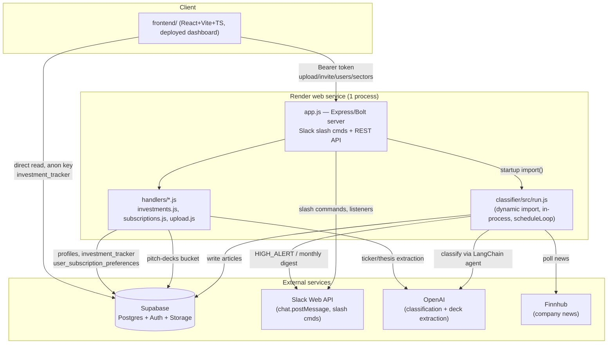

# SCIF Architecture

One deployed service (`app.js` on Render) + embedded classifier + Supabase backend + React dashboard.

## Diagram

## Components

### `app.js` (root) — entry point, single deployed process
Express + Slack Bolt (`ExpressReceiver`). Validates env vars at boot.
- Slack: `/upload`, `/subscribe`, `/hello`, message/file-share listeners, view/action handlers.
- REST: `/api/upload`, `/api/invite`, `/api/users` (GET/PUT/DELETE), `/health` — guarded by Supabase-JWT `requireAuth`/`requireGod`.
- On startup: dynamic `import()` of `classifier/src/run.js`, calls `scheduleLoop()` in-process, wrapped in `.catch()` so classifier failure can't kill the HTTP server.
- Talks to: Supabase (service-role), Slack Web API, OpenAI (via `handlers/upload.js`).

### `classifier/` — news classifier agent (embedded + standalone)
Own ESM package, also imported by `app.js`. Loop: `pollFinnhub → classifyAllPending → dispatchAll → maybeSendMonthlyOverview`, scheduled at 3 ET slots (08:30/13:00/16:30 weekdays).
- `finnhub.js` — pulls company news → `articles` table.
- `classify.js` + `tools.js` — LangChain `createAgent` (ChatOpenAI) w/ 4 tools, labels HIGH_ALERT / MONTHLY_OVERVIEW / IGNORE.
- `dispatch.js` / `monthly.js` / `slack.js` — post HIGH_ALERT immediately, batch MONTHLY_OVERVIEW at month start.
- `repo.js` / `supabase.js` — sole DB layer (service-role key).
- `seed.js` — seeds 3-company portfolio/theses.

### `frontend/` — active dashboard (React + Vite + TS, Tailwind, Zustand, react-router)
- Reads `investment_tracker` directly from Supabase (anon key, `lib/supabase.ts`) for display.
- Calls `app.js` REST API (`lib/api.ts`, `VITE_API_URL`, Bearer token) for privileged writes: upload, invite, user list/delete, sector updates.
- Auth via Supabase Auth (`useAuthStore.ts`, `ProtectedRoute.tsx`).
- Deployed as static SPA on Render (`public/_redirects`).

### `handlers/` — CommonJS modules, imported only by `app.js`
- `investments.js` — insert into `investment_tracker`.
- `subscriptions.js` — `user_subscription_preferences`, synced to `profiles.subscribed_sectors`.
- `upload.js` — PDF/PPTX text extraction + OpenAI ticker/thesis extraction.

### `supabase/migrations/0001_init.sql` — stale/incomplete schema
Defines `companies`, `theses`, `articles`, `subscriptions`. Tables `app.js`/`frontend/` actually use — `profiles`, `investment_tracker`, `user_subscription_preferences` — exist live but aren't in any committed migration. Root `migrations/` dir unused.

## External services

| Service | Used by | Purpose |
|---|---|---|
| Supabase | app.js, classifier, frontend | Postgres DB, Auth, Storage (`pitch-decks` bucket) |
| OpenAI | app.js (handlers/upload.js), classifier (LangChain agent) | Deck extraction, news classification |
| Finnhub | classifier | Company news polling |
| Slack | app.js, classifier, slack-bot | Slash commands, HIGH_ALERT/digest posts |

## Known drift

- `.env.example` (root) missing `OPENAI_API_KEY`, `FINNHUB_API_KEY`, `SLACK_CHANNEL_ID` — actually required by `app.js`/classifier at runtime.
- Schema drift: live DB has tables (`profiles`, `investment_tracker`, `user_subscription_preferences`) not reflected in `supabase/migrations/`.
