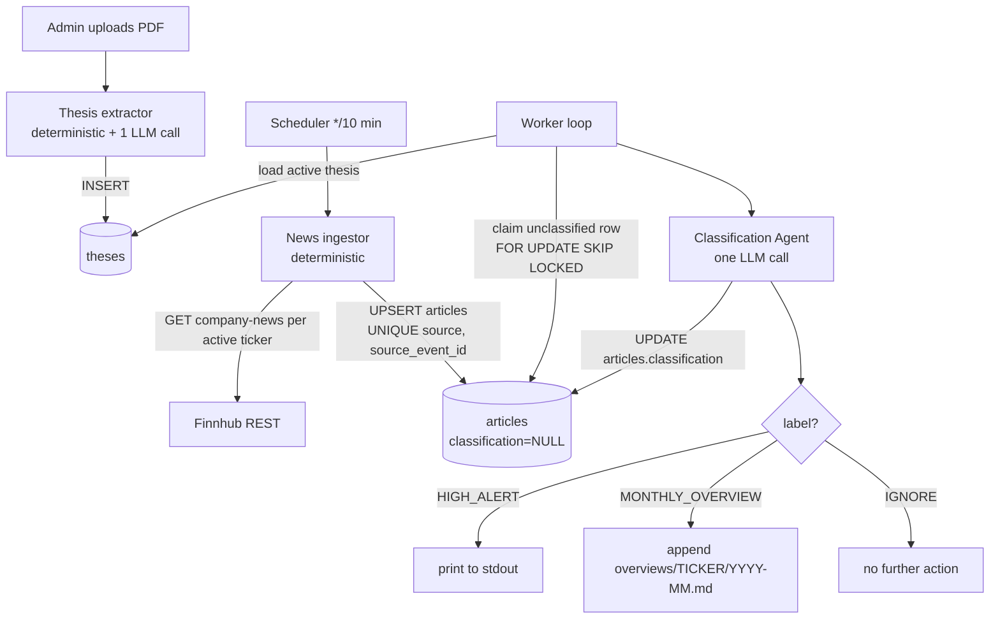

# SCIF Thesis Tracker — Agent Logic (`agent_logic.md`)

> Simplified scope. One agent. Everything else deterministic. Replaces all prior agent designs.

---

## 1. Agent System Overview

The SCIF Thesis Tracker has **exactly one agent**: the **Classification Agent**. It is the only place an LLM makes a routing decision. Every other moving part — thesis extraction, news polling, persistence, output dispatch — is a deterministic function.

The Classification Agent is implemented with LangChain's `createAgent` runtime from the `langchain` JS package (see `langchain_docs/oss/javascript/langchain/agents.md`). It is configured with `tools: []` and a `responseFormat` Zod schema, which per `langchain_docs/oss/javascript/langchain/agents.md` ("If an empty tool list is provided, the agent will consist of a single LLM node without tool-calling capabilities") collapses to one model call that returns a validated `structuredResponse`. No ReAct loop, no tools, no checkpointer.

End-to-end shape:

```
[ Admin uploads pitch deck ]
        │
        ▼
[ Thesis extraction — deterministic function, ONE LLM call ]
        │
        ▼
[ Thesis stored in DB ]

──────────────────────────────────────────────────────────

[ Scheduler ] every N minutes
        │
        ▼
[ News ingestion — deterministic Finnhub poller, portfolio-only ]
        │
        ▼
[ Articles stored in DB ]
        │
        ▼
[ Classification Agent — ONE LLM call per article ]
        │
        ├── HIGH_ALERT       → print to terminal (Slack later)
        ├── MONTHLY_OVERVIEW → append to local markdown file
        └── IGNORE           → discard
```

That's the entire system. There is no triage stage, no separate categorizer, no impact evaluator as a distinct step, no monthly narrative LLM, no digest generator, no subscription router, no Slack dispatcher service, no tier resolver, no multi-table job queue, no prompt-versioning machinery, and no `RunnableSequence` / `RunnableWithFallbacks` / `branch()` chain plumbing. The Classification Agent absorbs the categorize + triage + evaluate work into one `createAgent` call with three possible outcomes.

---

## 2. Agent Responsibilities

| Component | Agent? | Reads | Writes |
|-----------|--------|-------|--------|
| **Thesis extractor** | no — deterministic function with one LLM call | uploaded PDF | `theses` (structured thesis JSON + raw text) |
| **News ingestor** | no — deterministic Finnhub poller | Finnhub REST | `articles` (idempotent by `(source, source_event_id)`) |
| **Classification Agent** | **yes — only agent** | the article + the active thesis for the company it concerns | the classification result; if `HIGH_ALERT` prints to stdout; if `MONTHLY_OVERVIEW` appends to `overviews/<company>/<YYYY-MM>.md`; if `IGNORE` discards |

### Portfolio scope (hard rule)

Ingestion polls **only** companies the fund holds an active position in. Other tickers are filtered out at the source by checking `companies.ticker IN (active portfolio set)` before any Finnhub call. No article about a non-portfolio company ever enters the database. This is enforced in the ingestion function, not at the agent layer — the agent never sees the non-portfolio noise.

If a company is exited from the portfolio, ingestion for that ticker stops on the next poll cycle. Already-ingested articles remain in the DB for audit; the agent simply never re-evaluates them.

---

## 3. State & Memory Model

The "memory" of the system is the database plus one local file tree. The agent has no in-memory state across calls.

### Database tables

Three tables, plain Postgres, no extensions beyond `pgcrypto`. No `vector`, no `pgvector`, no embedding columns.

```sql
-- companies: the portfolio definition
create table companies (
  id          uuid primary key default gen_random_uuid(),
  ticker      text not null unique,
  name        text not null,
  sector      text,
  active      boolean not null default true,    -- false = exited; ingestion skips
  created_at  timestamptz not null default now()
);

-- theses: one active thesis per company (latest wins)
create table theses (
  id              uuid primary key default gen_random_uuid(),
  company_id      uuid not null references companies(id) on delete cascade,
  raw_deck_text   text not null,
  structured_json jsonb not null,    -- {growth_drivers, risks, catalysts,
                                     --  valuation_assumptions, key_metrics}
  active          boolean not null default true,
  created_at      timestamptz not null default now()
);
create index on theses (company_id) where active;

-- articles: every ingested news item from Finnhub
create table articles (
  id                uuid primary key default gen_random_uuid(),
  company_id        uuid not null references companies(id) on delete cascade,
  source            text not null,           -- 'finnhub_company_news', etc.
  source_event_id   text not null,           -- Finnhub `id` or composite hash
  headline          text not null,
  summary           text,
  url               text,
  published_at      timestamptz not null,
  raw_json          jsonb not null,
  classification    text check (classification in ('HIGH_ALERT','MONTHLY_OVERVIEW','IGNORE')),
  rationale         text,
  classified_at     timestamptz,
  ingested_at       timestamptz not null default now(),
  unique (source, source_event_id)            -- re-polling is a no-op
);
create index on articles (company_id, published_at desc);
create index on articles (classification, classified_at desc);
create index on articles (classification) where classification is null;  -- worklist
```

### Local file tree

```
overviews/
  <TICKER>/
    2026-05.md
    2026-06.md
    ...
```

Each markdown file is appended-to by the dispatcher when an article classifies as `MONTHLY_OVERVIEW`. One file per company per month. Plain text, no agent processing — the file IS the monthly overview. A human reads it directly.

### What each step reads and writes

| Step | Reads | Writes |
|------|-------|--------|
| Thesis extractor | uploaded PDF bytes | `theses` row |
| News ingestor | Finnhub REST; `companies` (active set) | `articles` rows (UPSERT by `(source, source_event_id)`) |
| Classification Agent | one `articles` row; one `theses` row (active for the article's company) | same `articles` row: sets `classification`, `rationale`, `classified_at` |
| Dispatcher | `articles` rows where `classification = 'HIGH_ALERT'` not yet printed | stdout |
| Dispatcher | `articles` rows where `classification = 'MONTHLY_OVERVIEW'` not yet appended | `overviews/<TICKER>/<YYYY-MM>.md` |

---

## 4. Agent Decision Flow

### 4.1 Deck upload → thesis (deterministic)

```
[ Admin uploads PDF for company NVDA ]
        ▼
extract_thesis(pdf_path, company_id):
  - text = pdfToText(pdf_path)              -- pdf-parse / PDFLoader
  - thesis = LLM.withStructuredOutput(ThesisSchema)
              .invoke(THESIS_EXTRACTION_PROMPT, { deck_text: text })
  - INSERT theses (company_id, raw_deck_text=text, structured_json=thesis,
                   active=true)
  - UPDATE theses SET active=false WHERE company_id=$1 AND id<>new.id
        ▼
[ NVDA now has exactly one active thesis ]
```

This is a plain function. No chain, no sub-agents, no prompt-versioning, no retries beyond a single 4xx retry. If the LLM call fails twice, the function raises and the admin sees an error in the upload UI.

### 4.2 News ingestion (deterministic, scheduled)

```
[ Scheduler fires every 10 min ]
        ▼
poll_news():
  tickers = SELECT ticker FROM companies WHERE active = true
  for ticker in tickers:                    -- rate-limited 5 req/s
    items = finnhub.GET /company-news?symbol=<ticker>
              &from=<yesterday>&to=<today>
    for item in items:
      INSERT articles (
        company_id, source='finnhub_company_news',
        source_event_id=item.id, headline=item.headline,
        summary=item.summary, url=item.url,
        published_at=to_ts(item.datetime), raw_json=item
      )
      ON CONFLICT (source, source_event_id) DO NOTHING
```

No classification happens here. Articles enter the table with `classification = NULL`. Re-polling is a no-op because of the UNIQUE constraint.

### 4.3 Classification Agent (the only agent)

```
[ Worker loop tick — every 30 seconds ]
        ▼
classify_pending():
  article = SELECT * FROM articles
              WHERE classification IS NULL
              ORDER BY published_at
              FOR UPDATE SKIP LOCKED LIMIT 1
  if not article: sleep 30s; return
  thesis = SELECT structured_json, raw_deck_text FROM theses
              WHERE company_id = article.company_id AND active = true

  // LangChain agent — one createAgent() instance reused across calls.
  // See langchain_docs/oss/javascript/langchain/agents.md (Structured output)
  // and langchain_docs/oss/javascript/langchain/structured-output.md.
  agent = createAgent({
    model:          initChatModel('openai:<LLM_MODEL>', { temperature: 0.1 }),
    tools:          [],                       // no ReAct loop; single LLM node
    systemPrompt:   CLASSIFICATION_SYSTEM_PROMPT,
    responseFormat: ClassificationSchema,     // Zod schema → structuredResponse
  })

  state = await agent.invoke({
    messages: [{ role: 'user', content: buildUserMessage(ticker, thesis, article) }]
  })
  result = state.structuredResponse           // { label, rationale }

  UPDATE articles
    SET classification = result.label,
        rationale = result.rationale,
        classified_at = now()
    WHERE id = article.id
  dispatch(article, result)
        ▼
dispatch(article, result):
  if result.label == 'HIGH_ALERT':
    print to stdout:
      "═══ HIGH_ALERT  <TICKER>  <published_at> ═══"
      "  headline: <article.headline>"
      "  rationale: <result.rationale>"
      "  url: <article.url>"
  elif result.label == 'MONTHLY_OVERVIEW':
    path = "overviews/<TICKER>/<YYYY-MM of published_at>.md"
    mkdir -p dir; append to file:
      "- **<published_at>** — <headline>"
      "  Rationale: <rationale>"
      "  URL: <url>"
      ""
  elif result.label == 'IGNORE':
    no further action (classification + rationale remain in DB for audit)
```

One LLM call per article. Three outcomes. That's the whole agent.

---

## 5. Prompt Contracts

Two prompts total: one for thesis extraction (deterministic step, plain model call with `.withStructuredOutput`), one for the Classification Agent (passed to `createAgent` as `systemPrompt`, schema enforced via `responseFormat`). Both use a Zod schema. No prompt-versioning system — the prompt is a string constant in the codebase; if it changes, the change shows up in git history like any other code.

Per `langchain_docs/oss/javascript/langchain/structured-output.md`, `responseFormat: ClassificationSchema` lets LangChain pick the strategy: `providerStrategy` (native structured output, e.g. OpenAI JSON schema) when the model profile advertises it, otherwise `toolStrategy` (a synthetic tool call that auto-retries on schema validation failure with a `ToolMessage` of error feedback). Either way the validated object lands in `state.structuredResponse`.

### 5.1 Thesis extraction prompt

```
[System]
You are an equity research analyst extracting the structured investment thesis from a pitch deck. Be faithful to the deck — do not invent claims. For each list item, write a single, self-contained sentence that a different analyst could later evaluate against real-world events. If a field is genuinely absent from the deck, return an empty array.

[User]
Pitch deck for {company_name} ({ticker}).

----- DECK TEXT -----
{deck_text}
----- END DECK -----

Return JSON conforming to the schema.
```

**Schema:**
```ts
const ThesisSchema = z.object({
  growth_drivers: z.array(z.string()),
  risks: z.array(z.string()),
  catalysts: z.array(z.string()),
  valuation_assumptions: z.array(z.string()),
  key_metrics: z.array(z.string()),
});
```

**Failure handling:** one retry on schema validation failure with the error appended. If still invalid, raise to the upload UI.

### 5.2 Classification Agent prompt

```
[System]
You are an equity research analyst. You read a single news article about a company in the fund's portfolio, alongside the fund's active investment thesis for that company, and you decide which of three buckets the article belongs in. You reason from the thesis as written — you do not import outside views. You consider whether the article materially supports, breaks, or threatens any element of the thesis.

Choose exactly one label:

- HIGH_ALERT: the article is material to the thesis AND time-sensitive. Examples: a key growth driver is confirmed, a stated risk has materialized, a guidance change, a C-suite departure, a regulatory action, a major customer win or loss, an analyst downgrade that directly contradicts the thesis. If a human analyst would want to know about this today, choose HIGH_ALERT.

- MONTHLY_OVERVIEW: the article is thesis-relevant but not urgent. Examples: a product launch that confirms a growth driver, a partnership that fits the catalysts list, slow-moving sentiment shifts, dividend changes, routine quarterly updates. A human analyst would want to read this at month-end but does not need to be paged today.

- IGNORE: the article is not relevant to the thesis. Examples: industry-wide news that does not touch the thesis components, generic market commentary, syndicated re-prints, articles that mention the ticker only in passing. Discard.

Return JSON with the label and a 1–3 sentence rationale citing the specific thesis element(s) the article touches (or stating "no relevant element" if IGNORE).

[User]
ticker: {ticker}
company: {company_name}

----- THESIS -----
Growth drivers:
{growth_drivers_bulleted}

Risks:
{risks_bulleted}

Catalysts:
{catalysts_bulleted}

Valuation assumptions:
{valuation_assumptions_bulleted}

Key metrics to watch:
{key_metrics_bulleted}
----- END THESIS -----

----- ARTICLE -----
Source: {source}
Published: {published_at}
URL: {url}
Headline: {headline}
Summary:
{summary}
----- END ARTICLE -----

Classify the article.
```

**Schema:**
```ts
const ClassificationSchema = z.object({
  label: z.enum(['HIGH_ALERT', 'MONTHLY_OVERVIEW', 'IGNORE']),
  rationale: z.string(),
});
```

This schema is passed to `createAgent({ responseFormat: ClassificationSchema })`. The system prompt above is passed as `systemPrompt`; the per-article user block is the single `HumanMessage` in `agent.invoke({ messages: [...] })`.

**Failure handling:** LangChain's `toolStrategy` already does one in-loop retry on schema validation failure with a `ToolMessage` describing the error (`langchain_docs/oss/javascript/langchain/structured-output.md` → "Schema validation error"). If the agent still throws (network, repeated validation, provider error), the worker catches it, marks `classification = 'IGNORE'` with `rationale = 'classification failed: <error>'`, and moves on. A human reviews the failed row out of band.

---

## 6. Routing & Escalation Rules

There is no tier system. There are no escalation rules. There are no subscriptions. There are no mutes. The Classification Agent's label is the routing decision, and the dispatcher acts on it deterministically:

| Label | Action |
|-------|--------|
| `HIGH_ALERT` | print one block to stdout, immediately |
| `MONTHLY_OVERVIEW` | append a bulleted entry to `overviews/<TICKER>/<YYYY-MM>.md` |
| `IGNORE` | nothing further; row remains in DB with the label for audit |

Duplicate handling: `articles` has UNIQUE `(source, source_event_id)`, so re-polling cannot produce duplicates. Each article is classified exactly once because the worker uses `FOR UPDATE SKIP LOCKED` and the UPDATE sets `classified_at`.

Slack delivery is explicitly out of scope for this build. When Slack is wired up, the dispatcher's `HIGH_ALERT` branch swaps `print()` for `chat.postMessage`. Nothing else changes.

---

## 7. Mermaid Agent Flow Diagram

One agent, one diagram.



---

## 8. Testing & Observability

### 8.1 Tests

- **Thesis extractor:** one fixture deck → one recorded LLM response → assert all five list fields populated, no empty thesis.
- **News ingestor:** one Finnhub response fixture → assert the right number of `articles` rows inserted, re-running yields zero new rows (idempotency).
- **Classification Agent:** a matrix of (thesis, article, expected_label) fixtures covering:
  - Article that confirms a growth driver → `MONTHLY_OVERVIEW`
  - Article that breaks a stated risk → `HIGH_ALERT`
  - Industry-wide news with no thesis touch → `IGNORE`
  - Guidance cut → `HIGH_ALERT`
  - Product launch fitting a catalyst → `MONTHLY_OVERVIEW`
  - Article that denies a rumored event → `IGNORE` (model must read the denial, not just the headline keyword)
- **Dispatcher:** assert `print()` is called for HIGH_ALERT; assert the markdown file gets the right line; assert IGNORE produces no side effects.

### 8.2 Observability

- **stdout** is the live alert feed. Run the worker under `tail -f` in dev.
- **`articles` table** is the audit trail. Every classification + rationale is persisted, so any disagreement with the model's call is reviewable by SQL: `SELECT classification, count(*) FROM articles GROUP BY 1;`.
- **`overviews/` markdown tree** is the human-readable archive. A diff against last month is the simplest "did anything change?" report.
- **LangSmith (optional):** wire `LANGSMITH_TRACING=true` and every Classification Agent call gets a trace. Useful for prompt iteration; not load-bearing for correctness.

### 8.3 Validating the agent

Three regular checks:

1. **Precision spot-check:** an analyst reads the day's `HIGH_ALERT` rows, marks any false positives. Track `false_positives / total_alerts`. Tune the prompt if drift appears.
2. **Recall spot-check:** an analyst reads the day's `IGNORE` rows for one or two tickers, marks anything that should have been `HIGH_ALERT` or `MONTHLY_OVERVIEW`. Recall failures are the more dangerous mode.
3. **Rationale audit:** sample 10 classifications/day; verify the `rationale` actually cites a thesis element when the label is HIGH_ALERT or MONTHLY_OVERVIEW.

---

## What this design removed (vs prior versions)

For the record, the following are gone:

- Triage agent
- Separate categorizer
- Impact evaluator as a distinct LLM step
- Monthly narrative generator (the markdown file IS the overview)
- Digest generator
- Subscription router
- Slack dispatcher service
- Tier-resolution rules (Tier 1 / 2 / 3)
- Multi-table job queue (`extract_deck`, `structure_thesis`, `categorize_event`, `evaluate_event`, `dispatch_alert`, `generate_rollup`)
- Prompt-versioning system (`@1.0.0` suffixes, `prompt_versions.md`, version-aware UNIQUE constraints)
- LangChain Runnable plumbing (`RunnableSequence`, `RunnableWithFallbacks`, `branch()`) — the Classification Agent uses `createAgent` with `tools: []` and `responseFormat` instead, which is one model call wrapped in the LangGraph agent runtime, not a hand-built chain
- Embeddings, pgvector, vector retrieval, top-k similarity
- Fallback model / cross-provider chain
- Per-thesis fan-out (one ticker = one thesis = one classification per article)

The Classification Agent absorbs the categorize + triage + evaluate work into one call with three possible outcomes.

---

## 9. MVP Build Phases (local-only)

Goal of the MVP: a single Node process running on a laptop that polls Finnhub for news about a small hardcoded portfolio, runs the Classification Agent on each new article, and dispatches results to stdout + local markdown files. No Supabase, no Render, no admin frontend, no Slack — those layers are added later once the agent is producing labels the team trusts.

Each phase is sequential. Finish and validate one before starting the next.

### Phase 0 — Scaffold

**Goal:** dedicated MVP directory next to the existing `app.js`, isolated dependencies, env vars in place.

```bash
cd /Users/rishits/scifxaic
mkdir -p mvp/{src,data,overviews}
cd mvp
npm init -y
# langchain + @langchain/core required; @langchain/openai provides ChatOpenAI.
# Versions per langchain_docs/oss/javascript/langchain/install.md.
npm install better-sqlite3 langchain @langchain/core @langchain/openai zod dotenv axios pdf-parse
```

Files to create:

- `mvp/.gitignore`
  ```
  node_modules/
  data/
  overviews/
  .env
  ```
- `mvp/.env`
  ```
  FINNHUB_API_KEY=<from finnhub.io>
  OPENAI_API_KEY=<your key>
  LLM_MODEL=gpt-5.5
  POLL_INTERVAL_MIN=10
  ```

**Validation:** `node -v` ≥ 20, `npm list better-sqlite3` shows the package.

### Phase 1 — Local DB + hardcoded portfolio & theses

**Goal:** SQLite database with three tables and seed data for 3 sample companies.

Files:

- `mvp/src/db.js`
  ```js
  import Database from 'better-sqlite3';
  import { mkdirSync } from 'node:fs';
  mkdirSync('./data', { recursive: true });
  export const db = new Database('./data/scif.db');
  db.pragma('journal_mode = WAL');
  db.exec(`
    create table if not exists companies (
      id integer primary key autoincrement,
      ticker text unique not null,
      name text not null,
      sector text,
      active integer not null default 1
    );
    create table if not exists theses (
      id integer primary key autoincrement,
      company_id integer not null references companies(id),
      structured_json text not null,
      active integer not null default 1,
      created_at text not null default current_timestamp
    );
    create table if not exists articles (
      id integer primary key autoincrement,
      company_id integer not null references companies(id),
      source text not null,
      source_event_id text not null,
      headline text not null,
      summary text,
      url text,
      published_at text not null,
      raw_json text not null,
      classification text check (classification in ('HIGH_ALERT','MONTHLY_OVERVIEW','IGNORE')),
      rationale text,
      classified_at text,
      dispatched_at text,
      ingested_at text not null default current_timestamp,
      unique (source, source_event_id)
    );
    create index if not exists idx_articles_pending
      on articles (classification) where classification is null;
  `);
  ```

- `mvp/src/seed.js` — hardcoded sample portfolio + theses. Run once.
  ```js
  import { db } from './db.js';

  const portfolio = [
    {
      ticker: 'NVDA', name: 'NVIDIA Corporation', sector: 'Semiconductors',
      thesis: {
        growth_drivers: [
          'Data-center GPU demand from generative-AI workloads grows >40% YoY through 2027.',
          'CUDA developer lock-in keeps software switching costs high.',
        ],
        risks: [
          'Hyperscalers shift to in-house silicon (Trainium, TPU, MTIA), cutting GPU orders.',
          'US export controls tighten and reduce China data-center revenue.',
        ],
        catalysts: [
          'Blackwell platform ramps in volume during fiscal H2.',
          'Sovereign-AI contracts announced with EU and Middle East buyers.',
        ],
        valuation_assumptions: [
          'Data-center gross margin sustains above 70%.',
          'Revenue grows >30% in the next 12 months.',
        ],
        key_metrics: ['Data-center revenue %', 'Gross margin', 'China revenue %'],
      },
    },
    {
      ticker: 'MSFT', name: 'Microsoft Corporation', sector: 'Software',
      thesis: {
        growth_drivers: [
          'Azure AI services drive Azure growth above 30% YoY.',
          'Copilot attach rate on M365 increases ARPU per enterprise seat.',
        ],
        risks: [
          'OpenAI relationship deteriorates or becomes more expensive.',
          'Regulatory action restricts product bundling.',
        ],
        catalysts: [
          'New Copilot SKUs announced at Ignite.',
          'Capex efficiency improvements reduce data-center build cost per token.',
        ],
        valuation_assumptions: [
          'Operating margin remains above 40%.',
          'Azure grows >28% in the next 12 months.',
        ],
        key_metrics: ['Azure growth %', 'Operating margin', 'Capex / revenue'],
      },
    },
    {
      ticker: 'LLY', name: 'Eli Lilly and Company', sector: 'Pharmaceuticals',
      thesis: {
        growth_drivers: [
          'GLP-1 franchise (Mounjaro/Zepbound) expands into new indications.',
          'Manufacturing capacity expansion resolves prior-year supply shortages.',
        ],
        risks: [
          'Compounded GLP-1 alternatives erode pricing power.',
          'Cardiovascular outcomes trial fails to show benefit.',
        ],
        catalysts: [
          'Obesity-related cardiovascular outcomes data readout.',
          'Medicare coverage expansion for obesity treatment.',
        ],
        valuation_assumptions: [
          'GLP-1 revenue grows >50% YoY in the next 12 months.',
          'Operating margin expands as supply constraints ease.',
        ],
        key_metrics: ['GLP-1 revenue', 'Manufacturing capacity', 'Operating margin'],
      },
    },
  ];

  const insertCompany = db.prepare(
    'insert or ignore into companies (ticker, name, sector) values (?, ?, ?)'
  );
  const insertThesis = db.prepare(
    'insert into theses (company_id, structured_json) values (?, ?)'
  );
  const findCompany = db.prepare('select id from companies where ticker = ?');

  for (const p of portfolio) {
    insertCompany.run(p.ticker, p.name, p.sector);
    const row = findCompany.get(p.ticker);
    const existing = db
      .prepare('select id from theses where company_id = ? and active = 1')
      .get(row.id);
    if (!existing) {
      insertThesis.run(row.id, JSON.stringify(p.thesis));
      console.log(`seeded thesis for ${p.ticker}`);
    } else {
      console.log(`thesis already exists for ${p.ticker}, skipping`);
    }
  }
  ```

**Validation:**
```bash
node src/seed.js
sqlite3 data/scif.db "select ticker, sector from companies; select count(*) from theses;"
```
Expect 3 companies, 3 theses.

### Phase 2 — Finnhub poller

**Goal:** deterministic function pulls company news for each active ticker, UPSERTs into `articles`.

File:

- `mvp/src/finnhub.js`
  ```js
  import 'dotenv/config';
  import axios from 'axios';
  import { db } from './db.js';

  const BASE = 'https://finnhub.io/api/v1';
  const KEY = process.env.FINNHUB_API_KEY;
  if (!KEY) throw new Error('FINNHUB_API_KEY missing');

  const ymd = (d) => d.toISOString().slice(0, 10);

  async function fetchCompanyNews(ticker, fromDate, toDate) {
    const url = `${BASE}/company-news?symbol=${ticker}&from=${fromDate}&to=${toDate}&token=${KEY}`;
    const res = await axios.get(url, { timeout: 15000 });
    return res.data ?? [];
  }

  const insertArticle = db.prepare(`
    insert or ignore into articles
      (company_id, source, source_event_id, headline, summary, url, published_at, raw_json)
    values (?, 'finnhub_company_news', ?, ?, ?, ?, ?, ?)
  `);

  export async function pollFinnhub() {
    const today = new Date();
    const yesterday = new Date(Date.now() - 24 * 60 * 60 * 1000);
    const tickers = db
      .prepare('select id, ticker from companies where active = 1')
      .all();

    let inserted = 0;
    for (const c of tickers) {
      try {
        const items = await fetchCompanyNews(c.ticker, ymd(yesterday), ymd(today));
        for (const it of items) {
          const result = insertArticle.run(
            c.id,
            String(it.id),
            it.headline ?? '(no headline)',
            it.summary ?? '',
            it.url ?? '',
            new Date(it.datetime * 1000).toISOString(),
            JSON.stringify(it)
          );
          if (result.changes > 0) inserted++;
        }
        console.log(`finnhub: ${c.ticker} -> ${items.length} fetched`);
        await new Promise((r) => setTimeout(r, 250)); // pace under 30 req/s
      } catch (e) {
        console.error(`finnhub error for ${c.ticker}:`, e.message);
      }
    }
    console.log(`finnhub poll done; new articles: ${inserted}`);
    return inserted;
  }

  if (import.meta.url === `file://${process.argv[1]}`) {
    pollFinnhub().then(() => process.exit(0));
  }
  ```

**Validation:**
```bash
node src/finnhub.js
sqlite3 data/scif.db "select count(*) from articles; select c.ticker, a.headline from articles a join companies c on c.id=a.company_id limit 5;"
```
Expect non-zero rows. Run twice; second run should add 0 new (idempotency).

### Phase 3 — Classification Agent

**Goal:** one LangChain `createAgent` invocation per unclassified article, three labels, write back. Agent is instantiated once at module load and reused across rows.

References:
- `langchain_docs/oss/javascript/langchain/agents.md` — `createAgent({ model, tools, systemPrompt, responseFormat })`, invocation via `agent.invoke({ messages })`.
- `langchain_docs/oss/javascript/langchain/structured-output.md` — `responseFormat` returns `state.structuredResponse`; tool-strategy auto-retries on schema validation error.
- `langchain_docs/oss/javascript/langchain/models.md` — `ChatOpenAI({ model, temperature, ... })` direct instantiation.

File:

- `mvp/src/classify.js`
  ```js
  import 'dotenv/config';
  import { z } from 'zod';
  import { createAgent } from 'langchain';
  import { ChatOpenAI } from '@langchain/openai';
  import { db } from './db.js';

  const MODEL = process.env.LLM_MODEL || 'gpt-5.5';

  const ClassificationSchema = z.object({
    label: z.enum(['HIGH_ALERT', 'MONTHLY_OVERVIEW', 'IGNORE']),
    rationale: z
      .string()
      .describe(
        "1-3 sentences citing the specific thesis element(s) the article touches, or 'no relevant element' if IGNORE.",
      ),
  });

  const SYSTEM_PROMPT = `You are an equity research analyst. You read a single news article about a company in the fund's portfolio, alongside the fund's active investment thesis for that company, and you decide which of three buckets the article belongs in. Reason from the thesis as written.

Choose exactly one label:

- HIGH_ALERT: material to the thesis AND time-sensitive. A human analyst would want to know today.
- MONTHLY_OVERVIEW: thesis-relevant but not urgent. A human analyst would want to read this at month-end.
- IGNORE: not relevant to the thesis.

Cite the specific thesis element(s) the article touches in the rationale.`;

  // One agent instance reused per process.
  // tools: [] -> single LLM node, no ReAct loop
  //   (langchain_docs/oss/javascript/langchain/agents.md, "If an empty
  //    tool list is provided, the agent will consist of a single LLM
  //    node without tool-calling capabilities").
  // responseFormat: Zod schema -> state.structuredResponse with auto-retry
  //   on validation failure
  //   (langchain_docs/oss/javascript/langchain/structured-output.md).
  const model = new ChatOpenAI({
    model: MODEL,
    temperature: 0.1,
    apiKey: process.env.OPENAI_API_KEY,
  });

  const classificationAgent = createAgent({
    model,
    tools: [],
    systemPrompt: SYSTEM_PROMPT,
    responseFormat: ClassificationSchema,
  });

  function buildUserMessage({ ticker, name, thesis, article }) {
    const bullets = (xs) => xs.map((x) => `- ${x}`).join('\n');
    return `ticker: ${ticker}
company: ${name}

----- THESIS -----
Growth drivers:
${bullets(thesis.growth_drivers)}

Risks:
${bullets(thesis.risks)}

Catalysts:
${bullets(thesis.catalysts)}

Valuation assumptions:
${bullets(thesis.valuation_assumptions)}

Key metrics:
${bullets(thesis.key_metrics)}
----- END THESIS -----

----- ARTICLE -----
Source: ${article.source}
Published: ${article.published_at}
URL: ${article.url}
Headline: ${article.headline}
Summary:
${article.summary || '(no summary)'}
----- END ARTICLE -----

Classify the article.`;
  }

  const claimRow = db.prepare(`
    select a.*, c.ticker, c.name, t.structured_json as thesis_json
    from articles a
    join companies c on c.id = a.company_id
    join theses    t on t.company_id = a.company_id and t.active = 1
    where a.classification is null
    order by a.published_at
    limit 1
  `);

  const markClassified = db.prepare(`
    update articles
    set classification = ?, rationale = ?, classified_at = current_timestamp
    where id = ?
  `);

  export async function classifyNext() {
    const row = claimRow.get();
    if (!row) return null;
    const thesis = JSON.parse(row.thesis_json);
    const userMsg = buildUserMessage({
      ticker: row.ticker,
      name: row.name,
      thesis,
      article: {
        source: row.source,
        published_at: row.published_at,
        url: row.url,
        headline: row.headline,
        summary: row.summary,
      },
    });

    let result;
    try {
      const state = await classificationAgent.invoke({
        messages: [{ role: 'user', content: userMsg }],
      });
      result = state.structuredResponse;
      if (!result) {
        throw new Error('agent returned no structuredResponse');
      }
    } catch (e) {
      console.error(`classify failed for article ${row.id}:`, e.message);
      markClassified.run('IGNORE', `classification failed: ${e.message}`, row.id);
      return { ...row, label: 'IGNORE', rationale: `failed: ${e.message}` };
    }

    markClassified.run(result.label, result.rationale, row.id);
    return { ...row, label: result.label, rationale: result.rationale };
  }

  export async function classifyAllPending() {
    let count = 0;
    while (true) {
      const r = await classifyNext();
      if (!r) break;
      count++;
      console.log(`classified article ${r.id} (${r.ticker}) -> ${r.label}`);
    }
    return count;
  }

  if (import.meta.url === `file://${process.argv[1]}`) {
    classifyAllPending().then((n) => {
      console.log(`done; classified ${n} articles`);
      process.exit(0);
    });
  }
  ```

**Validation:**
```bash
node src/classify.js
sqlite3 data/scif.db "select classification, count(*) from articles group by 1;"
```
Expect a mix of `HIGH_ALERT`, `MONTHLY_OVERVIEW`, `IGNORE`.

### Phase 4 — Dispatcher

**Goal:** read classified-but-undispatched articles, print HIGH_ALERTs to stdout, append MONTHLY_OVERVIEWs to per-ticker per-month markdown files.

File:

- `mvp/src/dispatch.js`
  ```js
  import { mkdirSync, appendFileSync } from 'node:fs';
  import { db } from './db.js';

  const pending = db.prepare(`
    select a.*, c.ticker
    from articles a
    join companies c on c.id = a.company_id
    where a.classification is not null
      and a.dispatched_at is null
    order by a.published_at
  `);
  const markDispatched = db.prepare(
    `update articles set dispatched_at = current_timestamp where id = ?`
  );

  export function dispatchAll() {
    const rows = pending.all();
    let alerted = 0, appended = 0, ignored = 0;
    for (const a of rows) {
      if (a.classification === 'HIGH_ALERT') {
        console.log(`\n═══ HIGH_ALERT  ${a.ticker}  ${a.published_at} ═══`);
        console.log(`  headline: ${a.headline}`);
        console.log(`  rationale: ${a.rationale}`);
        console.log(`  url: ${a.url}\n`);
        alerted++;
      } else if (a.classification === 'MONTHLY_OVERVIEW') {
        const month = a.published_at.slice(0, 7); // YYYY-MM
        const dir = `./overviews/${a.ticker}`;
        mkdirSync(dir, { recursive: true });
        const line =
          `- **${a.published_at}** — ${a.headline}\n` +
          `  Rationale: ${a.rationale}\n` +
          `  URL: ${a.url}\n\n`;
        appendFileSync(`${dir}/${month}.md`, line);
        appended++;
      } else {
        ignored++;
      }
      markDispatched.run(a.id);
    }
    console.log(`dispatch done: ${alerted} alerted, ${appended} appended, ${ignored} ignored`);
  }

  if (import.meta.url === `file://${process.argv[1]}`) {
    dispatchAll();
    process.exit(0);
  }
  ```

**Validation:**
```bash
node src/dispatch.js
ls overviews/
cat overviews/NVDA/2026-05.md   # if any NVDA articles classified MONTHLY_OVERVIEW
```

### Phase 5 — Runner loop

**Goal:** one script ties poll → classify → dispatch into a single cycle, looped at the configured interval.

File:

- `mvp/src/run.js`
  ```js
  import 'dotenv/config';
  import { pollFinnhub } from './finnhub.js';
  import { classifyAllPending } from './classify.js';
  import { dispatchAll } from './dispatch.js';

  const intervalMin = Number(process.env.POLL_INTERVAL_MIN || 10);

  async function cycle() {
    const t0 = Date.now();
    console.log(`\n── cycle start ${new Date().toISOString()} ──`);
    try {
      await pollFinnhub();
      await classifyAllPending();
      dispatchAll();
    } catch (e) {
      console.error('cycle error:', e);
    }
    console.log(`── cycle done in ${Math.round((Date.now() - t0) / 1000)}s ──`);
  }

  await cycle();
  setInterval(cycle, intervalMin * 60 * 1000);
  ```

Add `"type": "module"` to `mvp/package.json` so the ES-module `import` syntax works.

**Validation:**
```bash
node src/run.js
```
Watch the terminal for `HIGH_ALERT` blocks. After 10 minutes, the next cycle runs.

### What the MVP intentionally omits

- No admin frontend (theses are hardcoded in `seed.js`).
- No Slack — alerts go to stdout.
- No Supabase — local SQLite file at `data/scif.db`.
- No Render — runs on the laptop.
- No upgrade-downgrade, executive, filings endpoints — just `/company-news`. Add later by adding new `source` values to `articles` and new fetcher modules.
- No retry framework beyond one-shot `try/catch` per article — failed classifications become `IGNORE` with a recorded error so the worklist progresses.
- No prompt versioning — the prompt is a string in `classify.js`; git tracks changes.
- No LangGraph checkpointer / `thread_id` — each article is a fresh, stateless `agent.invoke` (`langchain_docs/oss/javascript/langchain/agents.md`: thread-based history is only needed when persisting conversation across turns).
- No middleware, no tools — the agent is intentionally a single LLM node with structured output.

### MVP file map (final)

```
mvp/
├── .env
├── .gitignore
├── package.json
├── data/scif.db                    # created at runtime
├── overviews/
│   ├── NVDA/2026-05.md
│   ├── MSFT/2026-05.md
│   └── LLY/2026-05.md
└── src/
    ├── db.js                       # SQLite schema + connection
    ├── seed.js                     # hardcoded portfolio + theses
    ├── finnhub.js                  # pollFinnhub()
    ├── classify.js                 # classifyNext(), classifyAllPending()
    ├── dispatch.js                 # dispatchAll()
    └── run.js                      # cycle loop
```

### Day-one happy path

```bash
cd /Users/rishits/scifxaic/mvp
npm install
node src/seed.js          # one-time
node src/run.js           # leave running
```

Within one cycle the terminal prints any `HIGH_ALERT`s, and `overviews/<TICKER>/<YYYY-MM>.md` files accumulate `MONTHLY_OVERVIEW` entries. The SQLite DB holds the full audit trail.

---

## 10. Migration Summary — Changes to Apply

Punch list for converting current `mvp/src/classify.js` (raw `openai` SDK) into LangChain agent. Each item cites source doc.

### Dependencies
- Remove `openai` from `mvp/package.json`.
- Add `langchain`, `@langchain/core`, `@langchain/openai`. Source: `langchain/install.md`.
- `npm install langchain @langchain/core @langchain/openai && npm uninstall openai`.

### `mvp/src/classify.js` rewrite
- Drop `import OpenAI from 'openai'`. Drop `new OpenAI({...})`.
- Add `import { createAgent } from 'langchain'`.
- Add `import { ChatOpenAI } from '@langchain/openai'`.
- Build model: `new ChatOpenAI({ model: MODEL, temperature: 0.1, apiKey: process.env.OPENAI_API_KEY })`. Source: `langchain/models.md`.
- Build agent at module top, reused across rows:
  ```js
  const classificationAgent = createAgent({
    model,
    tools: [],
    systemPrompt: SYSTEM_PROMPT,
    responseFormat: ClassificationSchema,
  });
  ```
  Source: `langchain/agents.md` + `langchain/structured-output.md`.
- Delete `callLLM()` helper and its `response_format: { type: 'json_object' }` JSON-mode plumbing.
- Replace per-row LLM call with:
  ```js
  const state = await classificationAgent.invoke({
    messages: [{ role: 'user', content: userMsg }],
  });
  const result = state.structuredResponse;
  ```
  Source: `langchain/agents.md` § Invocation, `langchain/structured-output.md` § Response format.
- Drop the inline JSON-instruction tail from `SYSTEM_PROMPT` ("Return JSON: {...}"). Schema enforcement now lives in `responseFormat`. Add `.describe(...)` on the rationale Zod field so model sees the contract via the schema.
- Keep outer `try/catch` → `IGNORE` fallback. Schema-validation retry already handled inside the agent by `toolStrategy`. Source: `langchain/structured-output.md` § Schema validation error.

### What stays unchanged
- `db.js`, `seed.js`, `finnhub.js`, `dispatch.js`, `run.js` — untouched.
- `ClassificationSchema` Zod definition — same three labels, same rationale field.
- DB columns, dispatcher behavior, worker loop, idempotency rules.
- Thesis extractor in §4.1 — still a plain model call (not an agent).

### Validation after migration
- `node src/classify.js` runs end-to-end against unclassified rows.
- `sqlite3 data/scif.db "select classification, count(*) from articles group by 1;"` shows mix of three labels.
- No `openai` import remains: `grep -r "from 'openai'" mvp/src` returns empty.
- Optional: `LANGSMITH_TRACING=true` env var → traces appear in LangSmith. Source: `langchain/agents.md` Tip box.

---

## 11. LangChain Source Map

Every Classification-Agent design choice maps back to a specific page under `langchain_docs/oss/javascript/`. Cite these when modifying the agent.

| Decision | Source |
|----------|--------|
| Use `createAgent` from `langchain` as the agent runtime | `langchain/agents.md` — "`createAgent()` provides a production-ready agent implementation." |
| `tools: []` to skip the ReAct loop and run a single LLM node | `langchain/agents.md` — "If an empty tool list is provided, the agent will consist of a single LLM node without tool-calling capabilities." |
| Static `systemPrompt: string` passed at construction time | `langchain/agents.md` § "System prompt" |
| `responseFormat: ClassificationSchema` (Zod) for label + rationale | `langchain/structured-output.md` — "LangChain's prebuilt ReAct agent `createAgent` handles structured output automatically." Result is on `state.structuredResponse`. |
| Auto-retry on schema validation failure (no hand-rolled retry) | `langchain/structured-output.md` § "Schema validation error" — tool strategy emits a `ToolMessage` with the validation error and re-invokes the model. |
| Provider-native vs tool-strategy chosen automatically | `langchain/structured-output.md` § "Response format" — strategy inferred from model profile when `responseFormat` is given directly. |
| `ChatOpenAI({ model, temperature, apiKey })` for full configuration of the underlying model | `langchain/models.md` — direct instantiation with provider params. |
| `agent.invoke({ messages: [{ role: 'user', content }] })` invocation pattern | `langchain/agents.md` § "Invocation". |
| No `checkpointer` / no `thread_id` (single-shot, stateless calls) | `langchain/agents.md` § "Invocation" — checkpointer/`thread_id` only required for persisting conversation history across turns. |
| Package install: `langchain @langchain/core @langchain/openai` | `langchain/install.md`. |

---

## 12. Tool-using classification agent

The Classification Agent is no longer a single-call LLM with `responseFormat`. It is a tool-using agent that gathers context through tool calls and commits its verdict by calling a final tool. The agent decides when it is done; the framework no longer parses a structured response.

Source pages (under `langchain_docs/oss/javascript/langchain/`):
- `agents.md` — `createAgent` runtime; "An agent runs until a stop condition is met — i.e., when the model emits a final output or an iteration limit is reached."
- `tools.md` — `tool(handler, { name, description, schema })` definition pattern; snake_case names; return strings or objects.
- `models.md` — `ChatOpenAI` direct instantiation.

### 12.1 The four tools

All four live in `mvp/src/tools.js` and are exported as a single `tools` array passed to `createAgent`.

| # | Tool | Inputs | Returns | When the agent should call it |
|---|------|--------|---------|-------------------------------|
| 1 | `get_thesis` | `{ ticker }` | `{ ticker, company, thesis: {growth_drivers, risks, catalysts, valuation_assumptions, key_metrics} }` | **Always, first.** The user message intentionally omits the thesis so the agent has to pull it. |
| 2 | `get_recent_classifications` | `{ ticker, limit? }` (default 5) | array of `{ article_id, headline, label, rationale, classified_at }` | When the headline is ambiguous and the agent wants to stay consistent with prior verdicts on similar items. |
| 3 | `fetch_article_body` | `{ article_id }` | A message stating the body is not available on the current Finnhub plan and instructing the agent to decide from headline + summary. | Only when the agent genuinely cannot decide from headline + summary. Per `finnhub_docs/company-news.md` no body field exists on free tier; the tool exists so the agent can ask, then proceed informed. |
| 4 | `classify_article` | `{ article_id, label, rationale }` | A confirmation string telling the agent its turn is done. Writes `classification + rationale + classified_at` to the DB, then calls `dispatchOne` so the entry is appended to `overviews/HIGH_ALERTS.md` or `overviews/MONTHLY_OVERVIEWS.md` immediately. IGNORE writes no file. | Exactly once, as the final action of the agent's turn. |

`classify_article` validates the label against the enum and refuses empty rationales by returning an error string the agent can act on. It also refuses to re-classify an already-classified row.

### 12.2 Agent shape

- Built once at module load via `createAgent({ model, tools, systemPrompt })`. No `responseFormat`; the verdict is committed through `classify_article`, not parsed from a final structured response.
- System prompt enumerates the four tools, the three labels, and the rule "call classify_article exactly once as the last step of your turn."
- Per-row user message contains **only** `ticker`, `article_id`, `published_at`, `url`, `headline`, `summary`. The thesis is intentionally not pre-loaded.

### 12.3 Termination contract

The agent's stop condition is "model emits a final output" (per `agents.md`). The final action should be a successful `classify_article` call.

After `agent.invoke` returns, `classifyNext()` checks the article's `classification` column:
- If set, the agent committed — return the verdict.
- If still NULL, the agent terminated without calling `classify_article`. The row is force-marked `IGNORE` with rationale `"Agent terminated without calling classify_article; recording IGNORE so the worklist progresses."` and dispatched. Treated as a non-transient failure.

Transient vs non-transient LLM errors (`401/403/429/5xx`) still halt the cycle without poisoning the worklist; non-transient errors still mark IGNORE so the queue drains.

### 12.4 Example trace — HIGH_ALERT

Article: NVDA, headline `"Nvidia's $81 Billion Blowout Hides A Major Warning"`.

```
user → "Article to classify: ticker=NVDA, article_id=199, …"

assistant → tool_call: get_thesis({ ticker: "NVDA" })
tool      → { ticker, thesis: { growth_drivers:[…GPU demand>40% YoY…],
                                  risks:[…export controls…],
                                  valuation_assumptions:[…revenue>30%…] } }

assistant → tool_call: classify_article({
              article_id: 199,
              label: "HIGH_ALERT",
              rationale: "Reports Q1 revenue growth and data-center demand
                          tied to the >30% revenue and >40% YoY data-center
                          GPU demand assumptions. Time-sensitive earnings update."
            })
tool      → "Recorded article 199 (NVDA) as HIGH_ALERT. You are done; do not call any more tools."

assistant → (final response, no further tool calls)
```

Side effects:
- `articles.classification = 'HIGH_ALERT'`, `rationale`, `classified_at` set.
- `overviews/HIGH_ALERTS.md` gains a new block, written from inside the `classify_article` tool.
- `articles.dispatched_at` set.

### 12.5 Example trace — IGNORE

Article: MSFT, headline `"Diamond Hill Large Cap Strategy Adds Microsoft Shares"`.

```
user → "Article to classify: ticker=MSFT, article_id=240, …"

assistant → tool_call: get_thesis({ ticker: "MSFT" })
tool      → { ticker, thesis: { growth_drivers:[…Azure>30%…],
                                  catalysts:[…Copilot SKUs…], … } }

assistant → tool_call: get_recent_classifications({ ticker: "MSFT", limit: 5 })
tool      → [ { headline:"Microsoft Q1 beats", label:"HIGH_ALERT", … },
              { headline:"Buffett trims MSFT", label:"IGNORE", … },
              … ]

assistant → tool_call: classify_article({
              article_id: 240,
              label: "IGNORE",
              rationale: "No relevant element. Fund-manager position-sizing news
                          does not touch Azure growth, Copilot ARPU, or operating margin.
                          Consistent with prior IGNORE on Buffett-trim article."
            })
tool      → "Recorded article 240 (MSFT) as IGNORE. You are done; do not call any more tools."
```

Side effects: DB row updated; no markdown file written (IGNORE skips the dispatcher's append branch); `dispatched_at` set so the row isn't re-processed.

### 12.6 What changed vs §11

The earlier design used `createAgent` with `tools: []` and a `responseFormat: ClassificationSchema`. That collapsed to a single LLM node returning `state.structuredResponse`. The new design replaces that pattern with four real tools and a terminal-action tool — the agent is doing work in the world, not just answering a question. `responseFormat` is no longer used.
